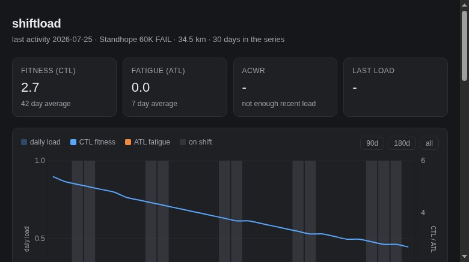
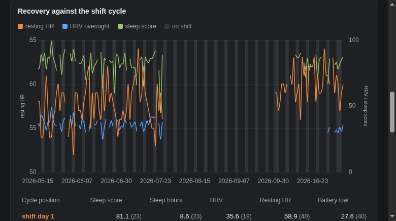

# shiftload

A self-hosted training load dashboard for my own Garmin data, read against a 48/96
firefighter shift schedule. It answers two questions I actually have: how much load am I
carrying, and does my recovery change across the six day shift cycle.



Everything runs on one laptop. Data comes out of Garmin's own API and my Fastmail
calendar, lands in a local SQLite file, and nothing goes anywhere else.

## What it does

- Pulls activities and daily wellness (sleep, HRV, resting HR, Body Battery, stress) from
  the official Garmin Connect Personal API.
- Downloads each activity's `.FIT` file and computes training load (TRIMP) from heart rate
  reserve, so the load number is mine and not a vendor's.
- Reads my FIRE calendar live over CalDAV and expands it properly: the recurring 48/96
  pattern plus every override, which covers trades, picked up extras, 24 hour shifts and
  cancellations. Change the calendar and the dashboard follows.
- Builds a daily series with fitness (CTL, 42 day), fatigue (ATL, 7 day), the
  acute:chronic ratio, and Foster monotony and strain.
- Averages recovery metrics by position in the shift cycle, with sample sizes attached so
  a thin bucket cannot pass itself off as a finding.



## Quick start

```bash
git clone https://github.com/jrbowlder/shiftload.git
cd shiftload

# 1. mint a personal API key at
#    https://connect.garmin.com/app/settings/personalApiToken
echo 'GARMIN_API_KEY=your-key' > .env && chmod 600 .env

# 2. run it
docker compose up -d --build
# dashboard on http://localhost:4534, syncing daily at 05:30 America/Denver
```

CalDAV credentials are read from `~/.config/vdirsyncer/config`, or from `CALDAV_USER` and
`CALDAV_PASS` if those are set. The compose file mounts that config read only, so the
password is never copied into the image.

Running it without Docker:

```bash
uv sync
uv run shiftload probe          # prove the key works
uv run shiftload sync           # backfill from 2026-01-01, then rebuild the series
uv run shiftload fit            # download FIT files and compute TRIMP
uv run shiftload recovery       # recovery means by cycle position
uv run shiftload serve          # the dashboard on port 4534
```

## Commands

| Command | What it does |
| --- | --- |
| `probe` | mints a token, prints the newest activities and today's vitals |
| `sync` | activities, wellness, calendar and the load series, idempotent |
| `fit` | downloads FIT files, computes TRIMP, `--force` to recompute |
| `recompute` | rebuilds the daily load series from what is already stored |
| `recovery` | prints recovery metrics bucketed by cycle position |
| `shifts` | prints shift days straight from the calendar |
| `serve` | runs the web app |
| `status` | row counts, latest activity, last sync |

## Notes

- The database is derived. Raw JSON, ICS and FIT files are archived under
  `~/shiftload-data/raw`, so a metric can be recomputed without asking Garmin again.
- Shift days are stored per date with a source of `calendar` or `cycle`. The cycle maths is
  a fallback for when the calendar cannot be read, and the page shows the difference
  rather than hiding it.
- The Garmin API key expires (up to a year). A 401 from the token endpoint means the key
  is dead, not that the code is broken.
- The container syncs at 05:30 and catches up on startup if the last good sync is more than
  20 hours old, which is what a laptop that sleeps overnight needs.
- Tests: `uv run pytest`.

## Licence

MIT
